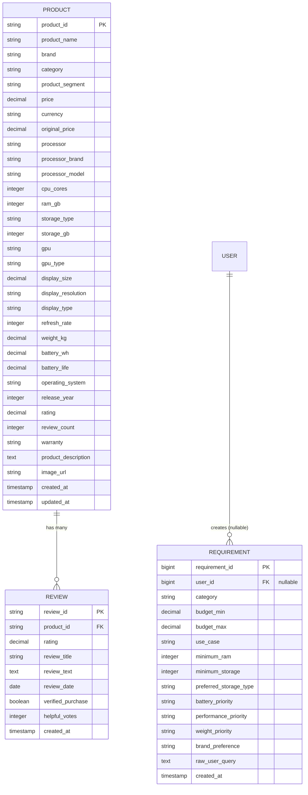

# SmartBuy AI — Database Design (Phase 3: Dataset Analysis & Schema Alignment)

---

## 1. Overview

This document specifies the database design and schema for **SmartBuy AI** aligned with the approved laptop and review datasets (`data/products.csv` and `data/reviews.csv`).

The relational database is **PostgreSQL**, managed via Django Object-Relational Mapping (ORM).

For the MVP, the target product category is **Laptop**.

---

## 2. Entity-Relationship Diagram

---

## 3. Detailed Schema Specifications

### 3.1 `products` Table (`apps.products.models.Product`)

Stores laptop catalog items aligned with dataset attributes.

* **Database Table Name**: `products`
* **Primary Key**: `product_id` (`varchar(50)`)

| Field Name | Django Field Type | PostgreSQL Type | Nullable | Required | Default | Validation & Constraints |
| :--- | :--- | :--- | :--- | :--- | :--- | :--- |
| `product_id` | `CharField(50)` | `varchar(50)` | No | Yes | Primary Key | PK (e.g. `"LAP0001"`) |
| `product_name` | `CharField(255)` | `varchar(255)` | No | Yes | — | Indexed |
| `brand` | `CharField(100)` | `varchar(100)` | No | Yes | — | Indexed |
| `category` | `CharField(100)` | `varchar(100)` | No | Yes | `'Laptop'` | Indexed |
| `product_segment` | `CharField(100)` | `varchar(100)` | No | No | `''` | Indexed (e.g. `"Gaming"`) |
| `price` | `DecimalField(12, 2)` | `numeric(12, 2)` | No | Yes | — | `price >= 0` |
| `currency` | `CharField(3)` | `varchar(3)` | No | Yes | `'INR'` | — |
| `original_price` | `DecimalField(12, 2)` | `numeric(12, 2)` | Yes | No | `NULL` | `original_price >= 0` |
| `processor` | `CharField(150)` | `varchar(150)` | No | No | `''` | Full string from dataset |
| `processor_brand` | `CharField(50)` | `varchar(50)` | No | No | `''` | Optional/derived |
| `processor_model` | `CharField(100)` | `varchar(100)` | No | No | `''` | Optional/derived |
| `cpu_cores` | `PositiveIntegerField` | `integer` | Yes | No | `NULL` | — |
| `ram_gb` | `PositiveIntegerField` | `integer` | No | Yes | — | `ram_gb > 0` |
| `storage_type` | `CharField(50)` | `varchar(50)` | No | Yes | — | — |
| `storage_gb` | `PositiveIntegerField` | `integer` | No | Yes | — | `storage_gb > 0` |
| `gpu` | `CharField(100)` | `varchar(100)` | No | Yes | — | — |
| `gpu_type` | `CharField(50)` | `varchar(50)` | No | No | `''` | `"Integrated"` / `"Dedicated"` |
| `display_size` | `DecimalField(4, 2)` | `numeric(4, 2)` | No | Yes | — | `display_size > 0` |
| `display_resolution`| `CharField(50)` | `varchar(50)` | No | Yes | — | — |
| `display_type` | `CharField(50)` | `varchar(50)` | No | No | `''` | `"IPS"`, `"OLED"`, etc. |
| `refresh_rate` | `PositiveIntegerField` | `integer` | No | Yes | `60` | — |
| `weight_kg` | `DecimalField(4, 2)` | `numeric(4, 2)` | No | Yes | — | `weight_kg > 0` |
| `battery_wh` | `DecimalField(5, 1)` | `numeric(5, 1)` | Yes | No | `NULL` | Watt-hour capacity |
| `battery_life` | `DecimalField(4, 1)` | `numeric(4, 1)` | Yes | No | `NULL` | Hours endurance |
| `operating_system` | `CharField(100)` | `varchar(100)` | No | Yes | — | — |
| `release_year` | `PositiveIntegerField` | `integer` | Yes | No | `NULL` | Release year |
| `rating` | `DecimalField(3, 2)` | `numeric(3, 2)` | No | Yes | `0.00` | `0 <= rating <= 5` |
| `review_count` | `PositiveIntegerField` | `integer` | No | Yes | `0` | `review_count >= 0` |
| `warranty` | `CharField(100)` | `varchar(100)` | No | No | `''` | Optional |
| `product_description`| `TextField` | `text` | No | No | `''` | Optional |
| `image_url` | `URLField(500)` | `varchar(500)` | Yes | No | `NULL` | Optional |
| `created_at` | `DateTimeField` | `timestamptz` | No | Auto | `NOW()` | Auto Add |
| `updated_at` | `DateTimeField` | `timestamptz` | No | Auto | `NOW()` | Auto Update |

---

### 3.2 `reviews` Table (`apps.reviews.models.Review`)

Stores individual customer reviews aligned with dataset attributes.

* **Database Table Name**: `reviews`
* **Primary Key**: `review_id` (`varchar(50)`)

| Field Name | Django Field Type | PostgreSQL Type | Nullable | Required | Default | Validation & Constraints |
| :--- | :--- | :--- | :--- | :--- | :--- | :--- |
| `review_id` | `CharField(50)` | `varchar(50)` | No | Yes | Primary Key | PK (e.g. `"REV00001"`) |
| `product_id` | `ForeignKey(Product)` | `varchar(50)` | No | Yes | — | FK → `products.product_id` (CASCADE) |
| `rating` | `DecimalField(3, 2)` | `numeric(3, 2)` | No | Yes | — | `1.00 <= rating <= 5.00` |
| `review_title` | `CharField(255)` | `varchar(255)` | No | No | `''` | Headline title |
| `review_text` | `TextField` | `text` | No | Yes | — | Review body |
| `review_date` | `DateField` | `date` | Yes | No | `NULL` | Publication date |
| `verified_purchase` | `BooleanField` | `boolean` | No | Yes | `false` | Verified buyer flag |
| `helpful_votes` | `PositiveIntegerField` | `integer` | No | Yes | `0` | Helpful count |
| `created_at` | `DateTimeField` | `timestamptz` | No | Auto | `NOW()` | Auto Add |

---

### 3.3 `requirements` Table (`apps.requirements.models.Requirement`)

* **Database Table Name**: `requirements`
* **Primary Key**: `requirement_id` (`BigAutoField`)

---

## 4. PostgreSQL Constraints

* `product_price_non_negative`: `price >= 0`
* `product_original_price_non_negative`: `original_price IS NULL OR original_price >= 0`
* `product_ram_gb_positive`: `ram_gb > 0`
* `product_storage_gb_positive`: `storage_gb > 0`
* `product_weight_kg_positive`: `weight_kg > 0`
* `product_rating_between_0_and_5`: `rating >= 0 AND rating <= 5`
* `review_rating_between_1_and_5`: `rating >= 1 AND rating <= 5`
* `requirement_budget_min_non_negative`: `budget_min >= 0`
* `requirement_budget_max_non_negative`: `budget_max >= 0`
